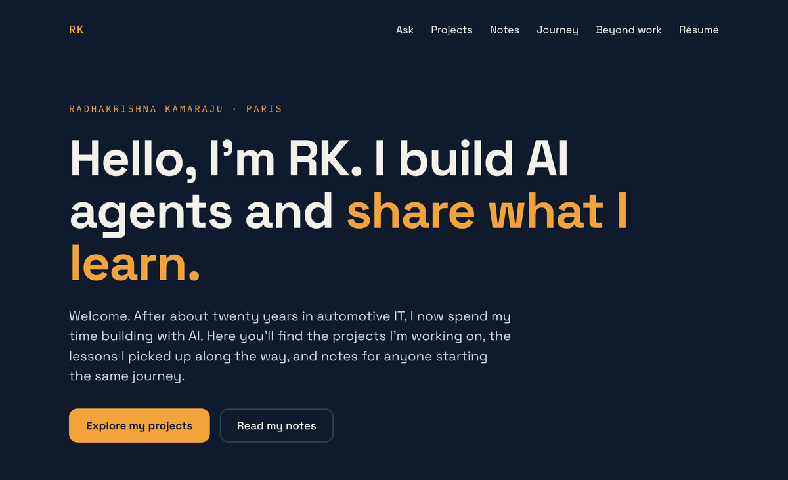
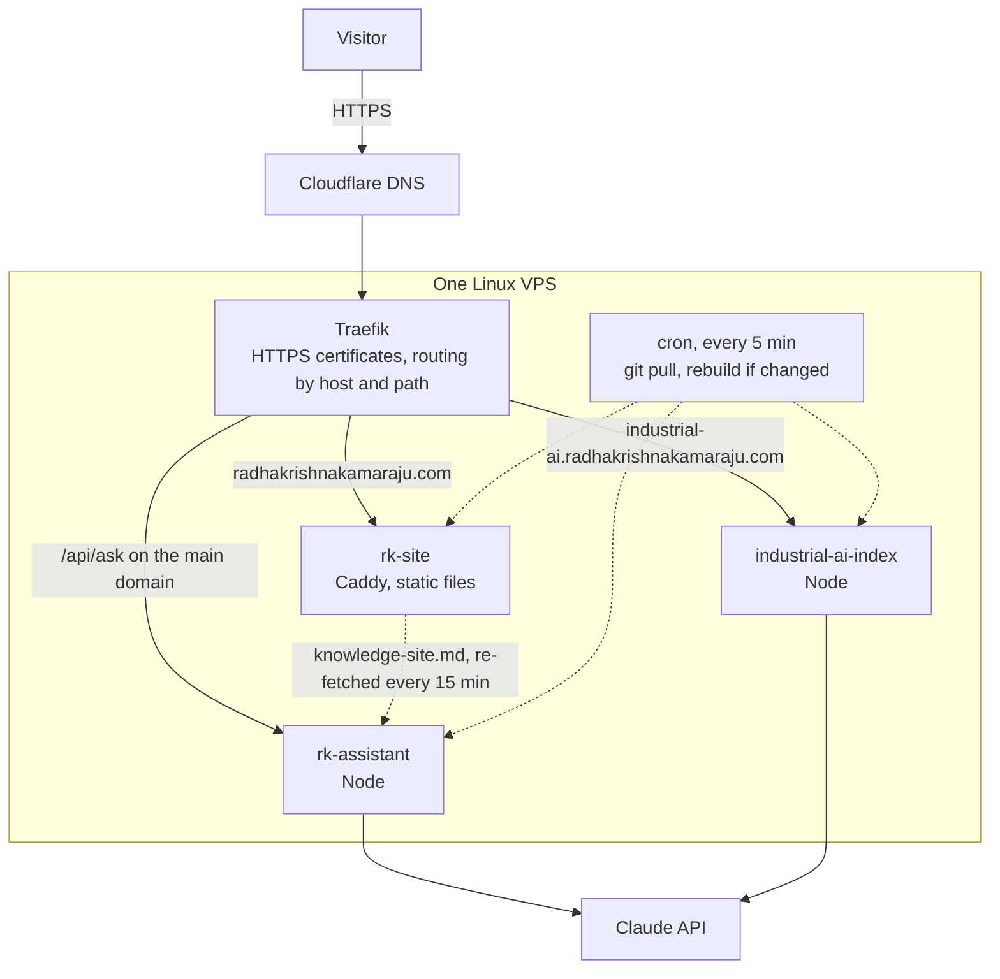
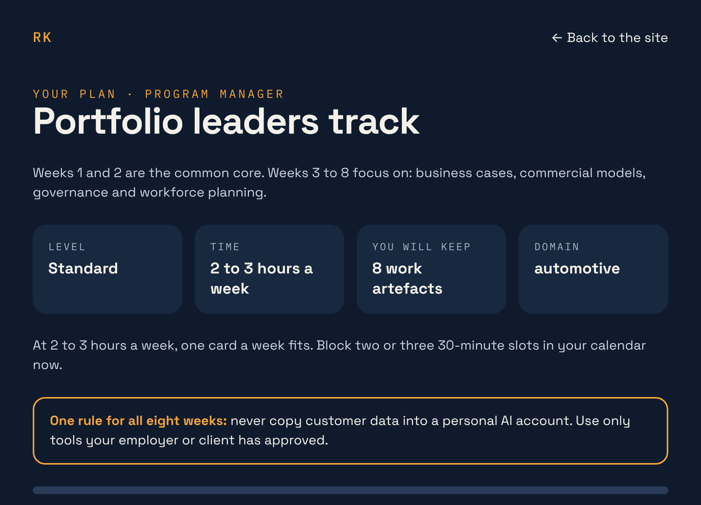

# radhakrishnakamaraju.com

**My personal site, and the small platform behind it: one server, three live apps, deployed by `git push`.**

**Live:** [radhakrishnakamaraju.com](https://radhakrishnakamaraju.com) · [AI Upskilling Planner](https://radhakrishnakamaraju.com/upskill/) · [Résumé (PDF)](https://radhakrishnakamaraju.com/Radhakrishna-Kamaraju-Resume.pdf)



## Why I built it

After twenty years in automotive IT, I wanted one place that shows what I build rather than describes it: the projects, the lessons, and notes for anyone starting the same journey. I also wanted to run it the way I'd expect a client's platform to be run: cheap, secure, and boring to deploy.

## The pieces

| Repo | What it is | Live |
|---|---|---|
| **rk-site** (this repo) | Static site served by Caddy, plus the AI Upskilling Planner and the résumé | [radhakrishnakamaraju.com](https://radhakrishnakamaraju.com) |
| [industrial-ai-index](https://github.com/radhakrishna-kamaraju/industrial-ai-index) | AI-readiness assessment for manufacturers, with a report written by Claude | [industrial-ai.radhakrishnakamaraju.com](https://industrial-ai.radhakrishnakamaraju.com) |
| [rk-assistant](https://github.com/radhakrishna-kamaraju/rk-assistant) | The "Ask this site" assistant, answering only from public site content | `POST /api/ask` on the main domain |

## Architecture



Each app is its own Docker container. None publishes a port: Traefik is the only way in.

## Design decisions

| Decision | Why | Trade-off |
|---|---|---|
| **One VPS, one container per app, no published ports** | Traefik routes by hostname and path and issues every HTTPS certificate. Adding an app takes a few labels in `docker-compose.yml`, not a server change. | Everything shares one machine, so a bad day for the VPS takes everything down. |
| **Deploy by `git push`** | A cron job pulls every 5 minutes and rebuilds only what changed. No CI service, and no secrets in GitHub: API keys live only in `.env` files on the server. | Up to 5 minutes of delay, and no automatic rollback (the fix is to revert and push). |
| **The assistant's knowledge is built from the real pages** | A two-stage Docker build runs `scripts/build-knowledge.js` over the actual planner data and publishes `/knowledge-site.md`. The assistant can't describe a page that doesn't exist, or miss one that does. | A new kind of page has to be added to the script once. |
| **The AI Upskilling Planner runs entirely in the browser** | Six questions in, an 8-week plan out. No backend, no API cost, nothing sent to a server. The plan's answers live in the URL, so sharing a plan means sharing the link. Ticked weeks are remembered only in the visitor's own browser. | No personalisation beyond the curated tracks until the optional AI step (phase 2). |
| **Résumé as code** | `resume/resume.html` is rendered to PDF by Playwright (`resume/build.py`). It's versioned in git like everything else: every change has a history, restyling is a CSS edit, and the site and the PDF stay in step. | Rebuilding needs a headless browser. |
| **Hardened static serving** | Caddy adds `nosniff`, `X-Frame-Options: DENY` and a strict referrer policy. Fonts are self-hosted, so the page sends no third-party requests. | Font files to keep up to date by hand. |

## The AI Upskilling Planner

An 8-week AI plan for busy IT professionals. Answer six short questions (role, time, current AI use, goal) and get one task a week built around your real work, across six role tracks: Builders, Quality engineers, Analysts and product owners, Delivery leads, Portfolio leaders and Operations.



## What broke, and what's next

**The planner could show nothing.** After the last question, the page saves the answers into the address bar so the plan can be shared. In some browser contexts, such as a sandboxed preview, the browser refuses that and throws an error. Because it happened *before* the plan was drawn, the visitor got a blank result. The fix makes the address-bar update optional: if the browser refuses it, the plan still renders, and only the shareable link is lost.

**The Ask box sent some questions twice**, which used up the rate limit early. This page now ignores a second submit while a question is being answered. The full story is in [rk-assistant](https://github.com/radhakrishna-kamaraju/rk-assistant#what-broke-and-whats-next).

**Next:**
- Phase 2 of the planner: an optional AI "tailor this to me" step.
- A newsletter link, once buildwithRKAI is published.
- A photo in the photography section.
- An automated check after each deploy that the site, the planner and the knowledge file all respond.

## This repo

- `site/index.html`: the whole page, styles and the assistant widget included.
- `site/upskill/`: the AI Upskilling Planner. `index.html` is the page and `data.js` holds the 8-week content for the six role tracks.
- `site/fonts/`: self-hosted Space Grotesk and IBM Plex Mono.
- `site/Radhakrishna-Kamaraju-Resume.pdf`: the public résumé, generated from `resume/resume.html`.
- `scripts/build-knowledge.js`: run by the Docker build; writes `/knowledge-site.md` from the real page content. When you add a page or tool, add it to this script.
- `Dockerfile`, `Caddyfile`, `docker-compose.yml`: the container and its Traefik labels.

## Deploy

Push to `main`. A cron job on the VPS pulls every 5 minutes and rebuilds the container only when something changed.

## Run locally

```
docker compose up --build
```

On the VPS, Traefik serves it. To preview on a laptop, add `ports: ["8081:80"]` to the service and open http://localhost:8081.

## Update the résumé

Edit `resume/resume.html`, run `python3 resume/build.py` (needs `pip install playwright` and `playwright install chromium`), and commit both the HTML and the PDF.

Built by [Radhakrishna Kamaraju](https://radhakrishnakamaraju.com) · [LinkedIn](https://www.linkedin.com/in/radhakrishna-kamaraju/) · [GitHub](https://github.com/radhakrishna-kamaraju)
